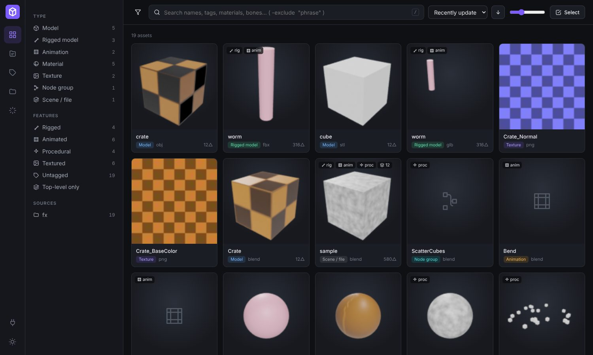
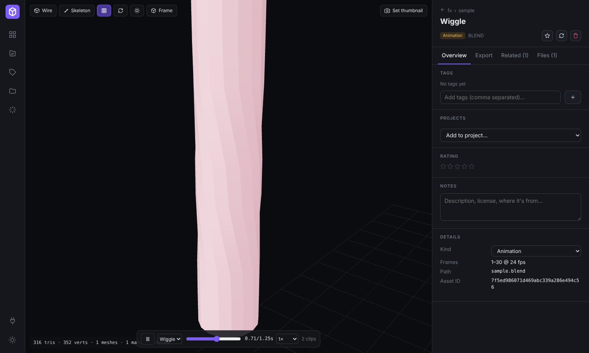
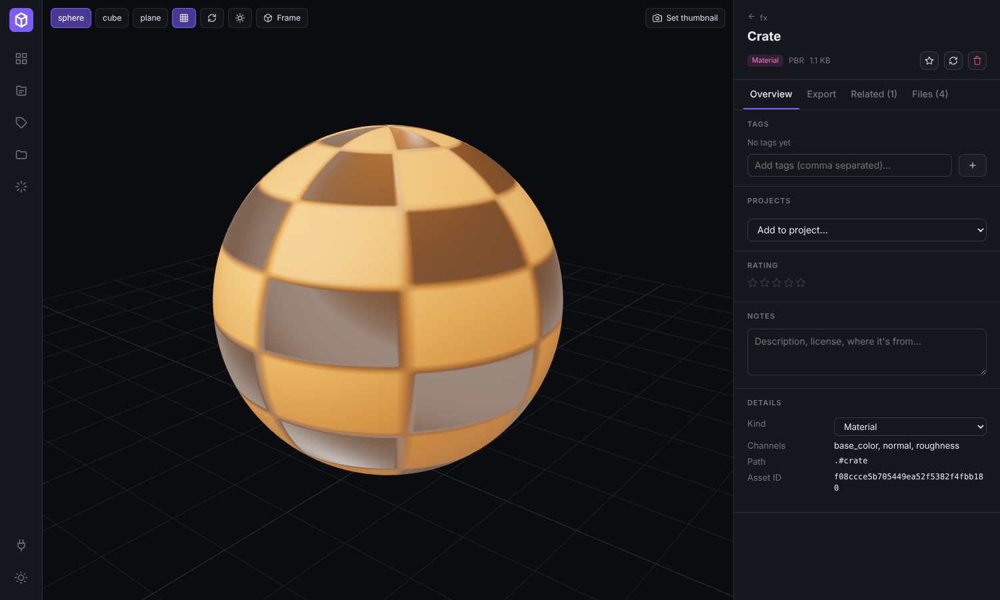
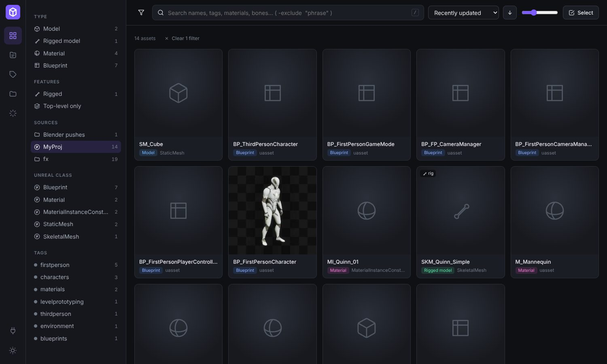
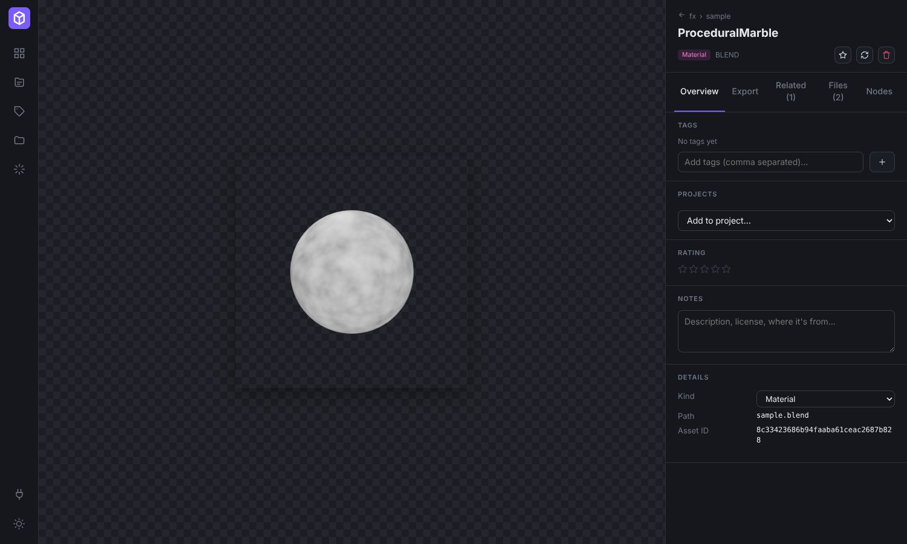
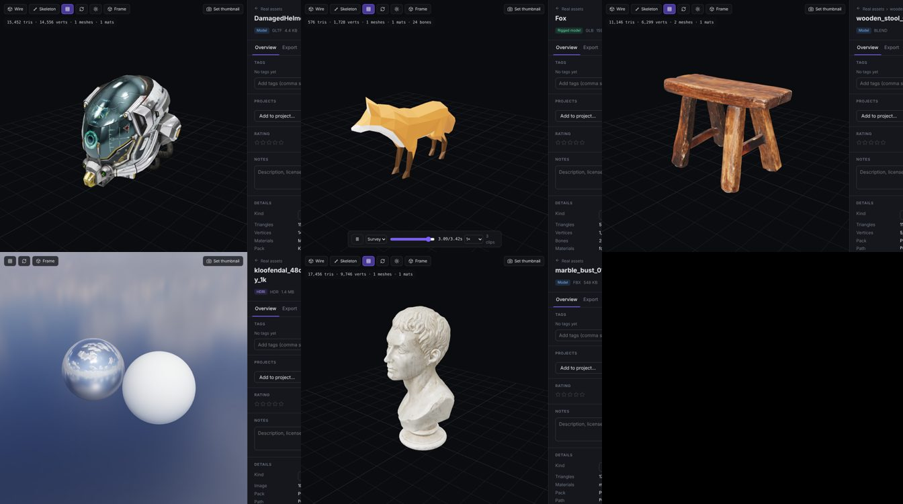

# Stash

**A self-hosted library for every 3D asset you own** – Fab / Unreal Marketplace content, Unreal
projects, `.blend` files, asset packs, Blender add-ons, textures and HDRIs – with a web UI that runs
as one Docker container on your NAS, and plugins that pull assets straight into Blender and Unreal
in the right format.



Tools like [Manyfold](https://github.com/manyfold3d/manyfold) do this well for 3D-printing files.
Stash covers game and DCC assets: rigs, animations, materials (including procedural node setups),
texture sets, Unreal packages and their dependencies. See [docs/RESEARCH.md](docs/RESEARCH.md) for
the existing projects I looked at and why this one is built from scratch.

## What it does

| | |
|---|---|
| **Index anything** | Point it at folders, Unreal projects, the Epic Launcher `VaultCache`, `.blend` files, zip asset packs or add-on folders. Linked in place (read-only) or copied into Stash. |
| **Split `.blend` files** | Every object hierarchy (or collection, or Blender-marked asset) becomes its own asset with a GLB preview, a self-contained `.blend` (textures packed) and a rendered thumbnail. Materials, actions, geometry/shader node groups and images become assets too, linked to what uses them. |
| **Understand Unreal content without Unreal** | Reads `.uasset`/`.umap` headers: asset class, engine version, dependencies, and the editor thumbnail stored in the package. Builds the material → texture → mesh → skeleton → animation graph. Tested against UE 4.27 – 5.7 packages. |
| **Texture sets** | Detects PBR sets from naming conventions (Megascans, Poly Haven, ambientCG, Substance, UE `T_*_N`), shows them on a live sphere/cube/plane, and attaches them to the models that use them. |
| **View** | three.js viewer for GLB/FBX/OBJ/STL/PLY/DAE/3MF/USDZ: play animations, scrub, show the skeleton, wireframe, HDRI preview, capture thumbnails from the current view. Node-tree view for Blender materials and geometry nodes. |
| **Organize** | Full-text search (names, tags, materials, bones, paths), facets by type/feature/source/Unreal class/tag, tags with colors & merge, ratings, favorites, notes, projects (collections) – all bulk-editable. |
| **Convert & export** | Any asset to `.blend` (procedural materials intact), glTF/GLB, FBX (generic / Unreal / Unity presets), OBJ, USD/USDZ, STL, PLY, Alembic; texture format conversion; an **Unreal package** (FBX + textures + manifest the plugin turns into material instances) or **native `.uasset`** with its whole dependency closure. Whole projects export to one zip. |
| **Into your DCC** | Blender add-on: browse/search in the N-panel, import (materials onto the selection, geo-nodes onto the active object, actions onto the active rig, HDRIs onto the world), push selections/files back. Unreal plugin: push Content Browser assets, import packages with auto-built material instances. Both can **receive** assets you click *Send to Blender/Unreal* on in the web UI. |
| **AI cataloguing (optional)** | With an Anthropic API key on the server, *AI tag* (per asset or on a whole selection) has Claude look at the thumbnail and metadata and add a category, search tags and a one-line description – handy for thousands of untagged pack assets. |
| **Housekeeping** | Pack facet (the asset pack each file came from), duplicate finder (same file in several places), missing-file tracking, scheduled rescans per source. |
| **Blender add-ons** | Add-ons/extensions in your sources are catalogued, and Stash serves a **Blender extension repository** – add one URL in Blender's preferences and install your own add-on collection from it. |

| Rigged + animated preview | PBR texture set | Unreal project | Procedural material |
|---|---|---|---|
|  |  |  |  |

Real downloads (Khronos glTF samples, Poly Haven `.blend`/FBX/texture sets/HDRI) after one scan –
textures relinked, rig animations playable, `.blend` split into model/material/textures:



## Quick start (Docker / NAS)

```bash
git clone https://github.com/w1zardxyz/stash && cd stash
# edit docker-compose.yml: mount your asset folders under /library
docker compose up -d --build
# open http://<nas>:8420  →  Sources  →  Add source  →  pick /library/...
```

The image bundles **Blender 4.5 LTS** (x86-64) for headless extraction, conversion and Cycles CPU
thumbnails. On ARM NAS boxes build with `--build-arg INSTALL_BLENDER=false`: indexing, viewing,
tagging, Unreal parsing and original-file downloads work; `.blend` splitting and conversions don't.

### Configuration (environment variables)

| Variable | Default | |
|---|---|---|
| `STASH_DATA_DIR` | `/data` | Database, previews, thumbnails, exports, uploads |
| `STASH_BROWSE_ROOTS` | `/library,/data/uploads` | Folders the *Add source* picker can browse |
| `STASH_WORKERS` | `2` | Parallel background jobs |
| `STASH_PASSWORD` | – | Require a password for the UI; also accepted as API token by the plugins |
| `STASH_API_TOKEN` | – | Extra token for plugins/scripts (`Authorization: Bearer …`) |
| `STASH_RENDER_THUMBNAILS` | `true` | Cycles CPU thumbnails for models/materials |
| `STASH_THUMBNAIL_SIZE` | `384` | Thumbnail size in px |
| `STASH_BLENDER` | auto | Path to a Blender binary (`none` to disable) |
| `STASH_BLENDER_TIMEOUT` | `1800` | Seconds per Blender job |
| `STASH_PUBLIC_URL` | – | External URL when behind a reverse proxy |
| `ANTHROPIC_API_KEY` | – | Enables AI tagging (Claude) |
| `STASH_AI_MODEL` | `claude-opus-5-5` | Model for AI tagging; `claude-haiku-5-5` is much cheaper for bulk runs |
| `STASH_AI` | auto | `false` disables AI tagging even when a key is present |

## Getting your Fab / Unreal Marketplace content in

Fab assets reach you in one of three ways; Stash handles each:

1. **Added to an Unreal project** (or sitting in the Epic Launcher vault cache,
   `…/Epic Games/Launcher/VaultCache/<Pack>/data/Content`): add the project folder or the
   `VaultCache` folder as a source. Stash indexes every package with its class, dependencies,
   engine version and embedded thumbnail. You can immediately download any asset as **native
   `.uasset` + dependencies** to drop into another project (same or newer engine).
2. **To get real meshes out of `.uasset`s** (for Blender, glTF, other engines): open the project in
   Unreal with the **StashBridge** plugin, select assets → right-click → *Push to Stash*. Stash
   matches them to the indexed packages, which then get 3D previews and every conversion.
   (Uncooked package bulk data is engine-internal and often Oodle-compressed, so the editor is the
   only reliable exporter – see [docs/UNREAL.md](docs/UNREAL.md).)
3. **Downloaded in "additional formats"** (FBX/OBJ/GLB/Blend zips, Megascans/Quixel zips): drop the
   zips into a source folder – Stash unpacks and indexes them.

## Integrations

* **Blender** (4.2+): Integrations page → *Download* → Preferences → Get Extensions → Install from
  Disk. N-panel → *Stash*. Details in [docs/BLENDER.md](docs/BLENDER.md).
* **Unreal Engine** (5.1+): unzip `StashBridge` into `YourProject/Plugins/`, restart the editor,
  *Stash → Edit settings…* to set the server URL. Details in [docs/UNREAL.md](docs/UNREAL.md).
* **Blender extension repository**: `http://<nas>:8420/api/blender/extensions/index.json`.
* **REST API**: everything the UI does – OpenAPI docs at `http://<nas>:8420/docs`.

## Development

```bash
# backend (Python 3.11+)
cd backend && pip install -r requirements.txt pytest httpx
STASH_DATA_DIR=./data python -m stash serve          # API + workers on :8420
python -m stash scan /path/to/assets                   # CLI: index a folder and run its jobs
python -m pytest -q                                    # tests (no Blender needed)

# frontend
cd frontend && npm install && npm run dev               # :5173, proxies /api to :8420
npm run build                                          # served by the backend from frontend/dist

# regenerate the Blender test fixtures
blender -b --factory-startup --python backend/tests/fixtures/make_fixtures.py -- /tmp/fx
```

Architecture, data model and pipeline details: [docs/ARCHITECTURE.md](docs/ARCHITECTURE.md).

## Status & limits

Working and tested in this repo: scanning, PBR detection, `.blend` extraction, previews, all
Blender-based conversions, the web UI, the Blender add-on (driven headlessly against a live
server), `.uasset` parsing (408/411 of UAssetAPI's UE 4.27–5.7 test packages), Docker image.

Not verified against a live Unreal Editor: the **StashBridge** plugin is written against the
documented UE 5.x Python API but hasn't been run inside the editor yet – expect small API-name
fixes on the first run. Other known limits:

* Mesh data of `.uasset`s needs the Unreal plugin (or the asset's other download formats).
* Substance `.sbsar` and 3ds Max/Maya/C4D scene files are indexed but not converted.
* Collada import was removed in Blender 5.0; the bundled 4.5 LTS still reads `.dae`.
* SQLite is used on purpose (zero setup, fine for a personal library of 100k+ assets);
  keep `/data` on a local volume rather than an SMB/NFS share.

## License

MIT
