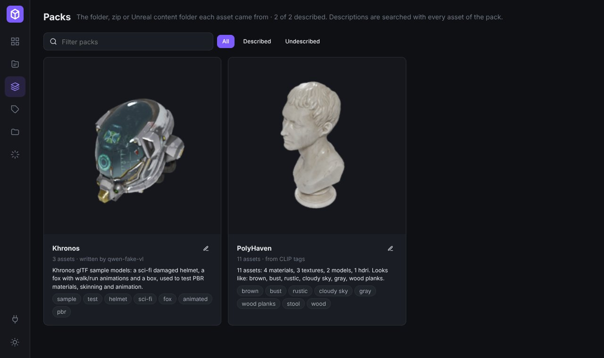

# Describing packs with a local LLM (LM Studio)

Most assets don't need a description of their own – their name, folder, tags and CLIP's visual
tags already find them. What's missing is context: *which* pack is the medieval village, which is
the sci-fi corridor kit. Stash stores that once per **pack** (the top-level folder, zip or Unreal
content folder an asset came from) and searches it with every asset of the pack.



You can type descriptions yourself (**Packs** page → ✎), or let a model write them in bulk with
`stash_describe.py`. The script runs on the computer that has the model (e.g. your MacBook), not on
the NAS, and needs only Python 3 – no packages to install.

## 1. LM Studio

1. Load a model. To let it look at previews, pick a **vision** model (the model page in LM Studio
   shows a "Vision" badge – e.g. a Qwen-VL or Gemma 3 build). A text-only model works too with
   `--images 0`; it then goes by asset names, folders and CLIP tags only.
2. Start the server: **Developer** tab → *Start server* (or `lms server start`). Default address:
   `http://localhost:1234/v1`.

## 2. Get the script

Stash → **Integrations** → *Pack descriptions with a local LLM* → **Script**, or:

```sh
curl -O http://<nas>:8420/api/integrations/stash_describe.py
```

## 3. Run it

```sh
python3 stash_describe.py --stash http://<nas>:8420 models          # check LM Studio is reachable
python3 stash_describe.py --stash http://<nas>:8420 --dry-run packs --limit 3   # try a few, save nothing
python3 stash_describe.py --stash http://<nas>:8420 packs           # every pack without a description
```

Add `--token <password>` if you set `STASH_PASSWORD`. Or put the settings in the environment once:

```sh
export STASH_URL=http://<nas>:8420 STASH_TOKEN=... LMSTUDIO_MODEL=<id from `models`>
```

What it sends per pack (`GET /api/packs/<name>`): asset counts per kind and format, the main
sub-folders, up to 150 asset names, existing tags, the CLIP tags aggregated over the pack, and
`--images` pictures (default 4: the pack's own preview images first, then thumbnails of different
kinds of assets, scaled to 512 px JPEGs). It asks for 1–3 factual sentences plus 5–12 search
keywords and saves them with `PUT /api/packs/<name>`. Only packs without a description are done,
so you can stop it (Ctrl-C) and run it again later; `--overwrite` redoes all,
`--only "Pack A" "Pack B"` redoes specific ones.

### Options worth knowing

| Option | |
|---|---|
| `--images N` | pictures per pack (0 for text-only models) |
| `--no-think` | appends `/no_think` – turns thinking off on Qwen3-style reasoning models (much faster, usually good enough for this) |
| `--min-assets N` | skip tiny packs |
| `--engine clip` | **no LLM at all**: writes "N assets: … Looks like: …" from the CLIP tags Stash already computed on the NAS |
| `--max-tokens`, `--timeout` | raise them for slow or very chatty reasoning models |

### Single assets (optional)

For the few places where per-asset descriptions help (e.g. a pack of 40 different characters):

```sh
python3 stash_describe.py assets --pack "Fantasy Characters" --kind skeletal_model --apply-tags
```

It refuses to run without a filter – describing a whole library one asset at a time is rarely
worth the hours. Existing descriptions are kept unless you pass `--overwrite`.

## Where it ends up

* `packs` table: `description`, `keywords`, `meta.by` = `lmstudio` (+ `model`) / `clip` / `user`.
* Search: the text is added to each asset's full-text entry (lower weight than the asset's own
  name and tags), so searching "harbor" finds every crate of the harbour pack.
* UI: **Packs** page, the banner above the library when it's filtered to a pack, and the *Pack*
  line on each asset page.

## Speed (estimates)

One pack = one request. On an Apple-silicon MacBook a 7–9B vision model typically answers in
roughly 5–30 s with four 512 px images (longer with thinking on), so a few hundred packs is a
coffee break to an hour. The NAS only serves summaries and small JPEGs.
